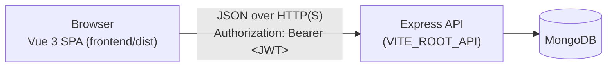

# 3339-Group-12-Project

**Data Platform**, the CIS 4339 course project for Group 12. It is a web app that a community
organization uses to manage its clients, services, and events, and to view attendance and
client-by-zip-code dashboards.

| Part | Stack | Location | Details |
| --- | --- | --- | --- |
| Frontend | Vue 3 (`<script setup>`), Vite 8, Tailwind CSS 4, Pinia, Vue Router, Axios, Chart.js | [`CIS-3339-Project/frontend`](CIS-3339-Project/frontend) | [Frontend README](CIS-3339-Project/frontend/README.md) |
| Backend | Node.js, Express, Mongoose, MongoDB | [`CIS-3339-Project/backend`](CIS-3339-Project/backend) | [Backend README](CIS-3339-Project/backend/README.md) |

The course requirements are in [`CIS-3339-Project/Project-README.md`](CIS-3339-Project/Project-README.md).

The current sprint covers the **frontend only**; backend work is planned for a later sprint (see
[Backend](#backend)).

## Architecture



- The frontend is a static single-page app. Every API call goes through one Axios client
  (`frontend/src/api/api.js`), which reads its base URL from `VITE_ROOT_API`, attaches the JWT, and turns
  error responses into readable messages. A `401` response logs the user out.
- After login, the JWT is stored in `localStorage` and the session is restored on page reload. Editor-only
  pages (`/clientform`, `/eventform`, `/serviceform`) are guarded by role.

## Prerequisites

- **Node.js 22.12+ or 24 LTS** (verified with Node 24.20.0 and npm 11.19.0)
  - Building needs `^20.19.0 || >=22.12.0` (Vite 8).
  - Running the tests needs `^22.12.0 || ^24 || >=26` (Vitest 5).
- **npm**, which ships with Node.js.
- A running backend API for data and login. Without one, the frontend still loads and shows
  "Unable to reach the server".

## Quick start

```bash
cd CIS-3339-Project/frontend
npm install
npm run dev        # http://localhost:5173
```

## Configuration

`CIS-3339-Project/frontend/.env` is **committed on purpose** (a course requirement for reproducible grading):

| Variable | Purpose |
| --- | --- |
| `VITE_ROOT_API` | Backend base URL (`http://localhost:3000`). It is embedded into the bundle at build time, so rebuild after changing it. Put personal overrides in `frontend/.env.local`, which is git-ignored. |

## Build, preview, and test

```bash
cd CIS-3339-Project/frontend
npm run build      # production bundle in frontend/dist
npm run preview    # serve the production build at http://localhost:4173
npx vitest run     # unit tests (useApi composable)
```

## Deployment (frontend)

`frontend/dist` is a static site. On any static host:

1. Set the root directory to `CIS-3339-Project/frontend`, the build command to
   `npm install && npm run build`, and the publish directory to `dist`.
2. Set `VITE_ROOT_API` to the backend URL **before** building.
3. Configure the **SPA fallback**: rewrite unknown paths to `/index.html` so that refreshing a nested route
   such as `/clientdetails/<id>` works. Per-host examples are in the
   [Frontend README](CIS-3339-Project/frontend/README.md#spa-fallback-required-for-static-hosting).
4. The backend's CORS policy must allow the frontend's origin; it currently allows every origin.

**Hosting used:** *TBD - not deployed yet. Record the host, settings, and URL here once deployed.*

## Backend

The backend is **out of scope for the current sprint** and has not been changed. To run it locally, follow
the [Backend README](CIS-3339-Project/backend/README.md). It needs a MongoDB database containing an
organization and users, and the configuration in `CIS-3339-Project/backend/.env`.

## Team

| Member | Sprint 2 responsibility |
| --- | --- |
| Diego Gonzalez | F1 (`App.vue`, dashboard, chart components) and D2 (production build, deployment docs) |
| Long Tran | F1 (CRUD views, forms, detail pages, login) |
| Joao Vitor Seron Bueno | F2 (`useApi()` composable, centralized Axios error handling) |
| Alex | F4 (session restoration, router guards, editor-only routes) |
| Krishna | F3 / C2 / C3 (reusable components: SearchBar, ConfirmationModal) |

## Known limitations

- **The frontend is not deployed yet.**
- Backend work (database initialization, server-side role checks and organization isolation, event
  registration rules) is planned for a later sprint.
- Role checks in the frontend are UX only; the backend must enforce them.
- The frontend must be served from the domain root unless Vite's `base` is changed (see the Frontend README).
