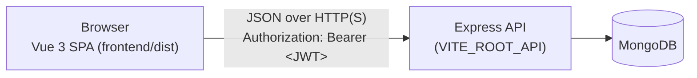

# 3339-Group-12-Project

**Data Platform**, the CIS 3339 course project for Group 12. It is a web app that a community
organization uses to manage its clients, services, and events, and to view attendance and
client-by-zip-code dashboards.

| Part | Stack | Location | Details |
| --- | --- | --- | --- |
| Frontend | Vue 3 (`<script setup>`), Vite 8, Tailwind CSS 4, Pinia, Vue Router, Axios, Chart.js | [`CIS-3339-Project/frontend`](CIS-3339-Project/frontend) | [Frontend README](CIS-3339-Project/frontend/README.md) |
| Backend | Node.js, Express 4, Mongoose 6, MongoDB, JWT (jsonwebtoken), bcryptjs | [`CIS-3339-Project/backend`](CIS-3339-Project/backend) | [Backend README](CIS-3339-Project/backend/README.md) |

The course requirements are in [`CIS-3339-Project/Project-README.md`](CIS-3339-Project/Project-README.md).

## Contents

- [Architecture](#architecture)
- [Prerequisites](#prerequisites)
- [Quick start (from scratch)](#quick-start-from-scratch)
- [Configuration (`.env` files)](#configuration-env-files)
- [Database initialization](#database-initialization)
- [Demo users](#demo-users)
- [API security summary](#api-security-summary)
- [Build, preview, and test](#build-preview-and-test)
- [Deployment](#deployment)
- [Team](#team)
- [Known limitations](#known-limitations)

## Architecture



- The frontend is a static single-page app. Every API call goes through one Axios client
  (`frontend/src/api/api.js`). It reads its base URL from `VITE_ROOT_API`, attaches the JWT, and turns
  error responses into readable messages. A `401` response logs the user out.
- After login, the JWT is stored in `localStorage` and the session is restored on page reload. Editor-only
  pages (`/clientform`, `/eventform`, `/serviceform`) are guarded by role in the frontend. The backend
  enforces the same rules on every request (see [API security summary](#api-security-summary)).
- One backend instance serves **one organization**: the one whose ID is in `ORG_ID`. Only users of that
  organization can log in to it. Every client, event, and service query is scoped to the organization in the
  user's JWT.

## Prerequisites

- **Node.js 22.12+ or 24 LTS** (verified with Node 24.15.0 and npm 11.12.1 on Windows 11)
  - The frontend build needs `^20.19.0 || >=22.12.0` (Vite 8), and its tests need
    `^22.12.0 || ^24 || >=26` (Vitest 5), so use 22.12+ for everything.
- **npm**, which ships with Node.js.
- **A MongoDB database**, either:
  - **MongoDB Atlas.** The committed `backend/.env` already points at the course-project Atlas cluster, so
    graders don't need to set anything up. Or
  - **a local `mongod`** (MongoDB 6 or 7), e.g. `MONGO_URL=mongodb://127.0.0.1:27017/dataplatform`.
- Running the backend tests does **not** need a database. They download and start a temporary in-memory
  MongoDB (about 600 MB on the first run, then cached).

## Quick start (from scratch)

Use two terminals. The commands are the same in PowerShell, Command Prompt, and bash.

**Terminal 1: backend** (http://localhost:3000)

```bash
cd CIS-3339-Project/backend
npm install
npm run db:init    # creates the orgs, demo users, and sample data; safe to run again
npm start          # or: npm run dev  (restarts automatically on file changes, via nodemon)
```

You should see `Database connection Success!` and `Server listening on port 3000`. Check it with
http://localhost:3000/health, which returns `{"status":"ok","db":"connected"}`.

**Terminal 2: frontend** (http://localhost:5173)

```bash
cd CIS-3339-Project/frontend
npm install
npm run dev
```

Open http://localhost:5173 and log in as `admin` / `admin` (editor) or `user` / `user` (viewer).

## Configuration (`.env` files)

Both `.env` files are **committed on purpose**. The course requires it so grading is reproducible (see
Project-README D1). They contain course-project-only credentials, which must be rotated after grading (see
[Known limitations](#known-limitations)). Variables that are already set in the environment take precedence
over the file (dotenv never overrides them). This is how the examples below override single values.

### `CIS-3339-Project/backend/.env`

| Variable | Committed value | What it does |
| --- | --- | --- |
| `MONGO_URL` | course Atlas cluster, database `dataplatform` | MongoDB connection string used by the server and by `npm run db:init`. The server exits at startup if it is missing. |
| `PORT` | `3000` | Port the API listens on. Hosts such as Render set their own `PORT`, which takes precedence. |
| `ORG_ID` | `64e0380b3cc28d087655693b` | The organization this backend instance serves. Login only accepts users of this org, and `db:init` creates the org with this ID. |
| `JWT_SECRET` | random 64-hex-character string | Secret used to sign and verify login tokens. Changing it logs everyone out. |
| `CORS_ORIGIN` | `http://localhost:5173,http://localhost:4173` | Comma-separated list of browser origins allowed to call the API (exact scheme, host, and port, with no path or trailing slash). Default: `http://localhost:5173`. See [CORS](#cors). |
| `SEED_VIEWER_USERNAME` / `SEED_VIEWER_PASSWORD` | `user` / `user` | Viewer account created by `db:init`. |
| `SEED_EDITOR_USERNAME` / `SEED_EDITOR_PASSWORD` | `admin` / `admin` | Editor account created by `db:init`. |

The `SEED_*` values are only read by `npm run db:init`. Passwords are stored as bcrypt hashes, never as
plain text.

### `CIS-3339-Project/frontend/.env`

| Variable | Committed value | What it does |
| --- | --- | --- |
| `VITE_ROOT_API` | `http://localhost:3000` | Backend base URL (no trailing slash). It is embedded into the bundle **at build time**, so rebuild after changing it. Put personal overrides in `frontend/.env.local` (git-ignored; template in `frontend/.env.example`). |
| `BASE_PATH` *(not in the file)* | unset (`/`) | Build-time sub-path the app is served from. The GitHub Pages workflow sets `/3339-Group-12-Project/`. |

## Database initialization

```bash
cd CIS-3339-Project/backend
npm run db:init
```

The script (`backend/scripts/initDb.js`) first checks `.env`. If any setting is missing or invalid, it lists
the problems and exits with code `1` before connecting. Then it creates whatever is missing:

- the organization `ORG_ID` ("Community Health Center") and a second organization
  `64e0380b3cc28d087655694c` ("Outreach Partner Org") for the isolation demo
- the demo users below, with bcrypt-hashed passwords
- 15 services, 16 clients, and 16 events in the main org (events run from 50 days ago to 25 days ahead, and
  the first 8 have registered attendees, so the dashboard has data), plus one service, client, and event in
  the second org
- the unique indexes declared in the models

It prints a summary of what it created and what was already present. **Running it again creates no
duplicates.** Every record is looked up by a stable key first. A rerun also resets the demo accounts'
passwords and roles to the values in `.env`.

### Reset (destructive)

```bash
npm run db:reset              # same as: npm run db:init -- --reset
```

> **Warning:** `--reset` permanently **deletes every client, event, service, user, and org belonging to the
> two seeded organizations**, including anything created through the app, and then seeds them again. With
> the committed `.env`, that is the shared course database. Other organizations are not touched. Only use it
> when you want a clean demo state.

## Demo users

| Username | Password | Role | Organization | Can log in to |
| --- | --- | --- | --- | --- |
| `admin` | `admin` | editor (read + create/update/delete/register) | `64e0380b3cc28d087655693b` (Community Health Center) | the normal backend (`ORG_ID` from `.env`) |
| `user` | `user` | viewer (read only) | `64e0380b3cc28d087655693b` (Community Health Center) | the normal backend |
| `partner` | same as `SEED_VIEWER_PASSWORD` (`user`) | viewer | `64e0380b3cc28d087655694c` (Outreach Partner Org) | a second backend instance started with that `ORG_ID` (below) |

### Organization isolation demo

Because each backend instance serves one org, start a second instance for the partner org on port 3001,
pointing at the same database:

```powershell
# PowerShell
cd CIS-3339-Project/backend
$env:ORG_ID = '64e0380b3cc28d087655694c'; $env:PORT = '3001'; npm start
```

```bash
# bash
cd CIS-3339-Project/backend
ORG_ID=64e0380b3cc28d087655694c PORT=3001 npm start
```

Log in as `partner` on port 3001 and you see only that org's one client ("Other Client"). Requesting any
record from the main org by its ID returns `404`. The same happens the other way round: `admin` on port 3000
gets `404` for the partner org's client, event, or service, even for updates and deletes. (Logging in as
`partner` on port 3000 fails with `401`.) The examples are in the
[Backend README](CIS-3339-Project/backend/README.md#verifying-the-security-rules-with-curl).

## API security summary

Three middleware functions, used the same way in every client, event, and service route:

| Piece | File | Behavior |
| --- | --- | --- |
| `requireAuth` | `backend/auth/authMiddleWare.js` | Requires `Authorization: Bearer <JWT>`. Missing token: `401 {"error":"Authentication required"}`. Invalid or expired: `401 {"error":"Invalid or expired token"}`. On success, sets `req.user = { name, role, orgId }`. |
| `requireRole('editor')` | `backend/auth/authMiddleWare.js` | Runs after `requireAuth`. Any other role gets `403 {"error":"You do not have permission to perform this action"}`. |
| `withOrg(filter, req)` | `backend/auth/withOrg.js` | Merges `{ org: req.user.orgId }` (`orgs` for clients) into **every** query filter. The org always comes from the verified JWT, never from the body, query string, or URL. Request bodies cannot set `org`, `orgs`, `_id`, or `$`-operators. |

| Operation | Requires |
| --- | --- |
| Read clients, events, services, dashboards | `requireAuth` |
| Create, update, delete, register, deregister | `requireAuth` + `requireRole('editor')` |
| `POST /users/login`, `GET /org`, `GET /health` | public |

**Status rules**

- `401`: not logged in, or a bad/expired token. A failed login always returns
  `401 {"error":"Invalid username or password"}`, whether the username exists or not.
- `403`: a viewer calls a mutating endpoint (including directly with curl or Postman).
- `404`: the record doesn't exist, **or belongs to another organization** (other orgs' records are never
  revealed). Malformed IDs also return `404`.
- `409`: a delete is blocked by references (a client registered for events, an event with attendees, or a
  service used by events).
- `400`: validation errors and malformed JSON. `500`: unexpected errors, with the message
  `"Internal server error"`.

**Event registration (B1):** `PUT /events/register?event=<id>&client=<id>` and
`PUT /events/deregister?event=<id>&client=<id>` (editor only). Both the event and the client must exist in
the user's org, or the response is `404`.

| Call | Response |
| --- | --- |
| First register | `201 {"message":"Client registered for event","eventId":…,"clientId":…}` |
| Register again | `200 {"message":"Already registered"}` (no duplicate attendee) |
| First deregister | `200 {"message":"Client deregistered from event","eventId":…,"clientId":…}` |
| Deregister someone not registered | `200 {"message":"Not registered"}` |

**Error shape (B2):** every error, including unknown routes, returns `{ "error": "Human readable message" }`,
and never a stack trace or a raw Mongo error. Successful create, update, and delete calls return a plain
string (e.g. `Service deleted successfully`), which the frontend shows as a toast.

**Health check:** `GET /health` needs no login and returns `{"status":"ok","db":"connected"}` (or
`"disconnected"`).

The full endpoint list is in the [Backend README](CIS-3339-Project/backend/README.md#endpoints).

## Build, preview, and test

```bash
cd CIS-3339-Project/frontend
npm run build      # production bundle in frontend/dist
npm run preview    # serve the production build at http://localhost:4173
npx vitest run     # frontend unit tests (useApi composable, success and failure)
```

```bash
cd CIS-3339-Project/backend
npm test           # backend tests: Jest + Supertest against an in-memory MongoDB
```

The backend tests never touch the real database. They cover login and the `401`/`403` rules
(a viewer gets `403` and an editor succeeds on the same route), organization isolation, the B1 registration
rules, and the error shape and `/health`. Results on the verification run: frontend 4/4 passed, backend
33/33 passed.

**Using the production build with the local backend.** `npm run preview` serves from
`http://localhost:4173`. The committed `CORS_ORIGIN` allows both `http://localhost:5173` (dev server) and
`http://localhost:4173` (production preview), so `npm start` works with either one without any override.

CI runs both test suites: [`backend-tests.yml`](.github/workflows/backend-tests.yml) on backend changes, and
the frontend tests inside the Pages workflow.

## Deployment

### Frontend: GitHub Pages

**Hosting used:** GitHub Pages, at https://joao-vitor-seron-bueno.github.io/3339-Group-12-Project/

- The workflow [`.github/workflows/deploy-frontend.yml`](.github/workflows/deploy-frontend.yml) tests and
  builds the frontend on every push or pull request to `dev` or `main` that changes
  `CIS-3339-Project/frontend/`. It publishes to Pages only from `main`. You can also run it by hand from the
  *Actions* tab.
- **One-time setup** (a repository admin): *Settings > Pages > Build and deployment > Source:*
  **GitHub Actions**. The site goes live after that and the first successful run.
- The workflow builds with `BASE_PATH=/3339-Group-12-Project/`, because Pages serves project sites from
  `/<repo>/`.
- **SPA fallback:** the workflow copies `index.html` to `404.html`. Pages serves that file for unknown paths,
  so refreshing or directly opening a nested route such as `/clientdetails/<id>` loads the app and the router
  shows the right page. Other hosts need an equivalent rewrite to `index.html`. See the
  [Frontend README](CIS-3339-Project/frontend/README.md#spa-fallback-required-for-static-hosting).

### Backend: Render web service

> **Backend URL:** `https://<service-name>.onrender.com` *(fill in after the service is created)*

1. Create a free account at https://render.com and choose **New > Web Service**. Connect this GitHub
   repository.
2. Settings:

   | Setting | Value |
   | --- | --- |
   | Branch | `main` |
   | Root Directory | `CIS-3339-Project/backend` |
   | Runtime | Node |
   | Build Command | `npm ci` |
   | Start Command | `npm start` |
   | Health Check Path | `/health` |
   | Instance Type | Free |

3. **Environment variables:** copy `MONGO_URL`, `ORG_ID`, `JWT_SECRET`, and the four `SEED_*` values from
   `backend/.env`. Add `NODE_VERSION=24`. Don't set `PORT`, because Render provides it. Set
   `CORS_ORIGIN` to the deployed frontend's origin, plus the local origins if you still want them:

   ```
   CORS_ORIGIN=https://joao-vitor-seron-bueno.github.io,http://localhost:5173,http://localhost:4173
   ```

   The origin is only scheme and host, with no `/3339-Group-12-Project` path and no trailing slash. (The
   committed `.env` is also in the deployed checkout. The dashboard values take precedence, so only
   `CORS_ORIGIN` strictly has to be set there.)
4. **MongoDB Atlas network access:** Render's free tier has no fixed outbound IP. In Atlas, under
   *Network Access*, allow `0.0.0.0/0` for the course cluster (the cluster is protected by its database
   user and password).
5. Deploy. When the logs show `Server listening on port …`, check
   `https://<service-name>.onrender.com/health` and confirm it returns `{"status":"ok","db":"connected"}`.
   The database is already initialized. To initialize a new database, run `npm run db:init` locally with
   `MONGO_URL` pointing at it.

### Connecting the two

1. In GitHub: *Settings > Secrets and variables > Actions > Variables > New repository variable*. Set
   `VITE_ROOT_API` = `https://<service-name>.onrender.com` (HTTPS, no trailing slash). The workflow writes
   it to `.env.local` before building, so the committed `frontend/.env` stays unchanged.
2. Re-run the Pages workflow: *Actions > Deploy frontend to GitHub Pages > Run workflow* on `main`.
3. Open the site, log in, and refresh a nested route. In the browser's network tab, API calls should go to
   the Render URL and return `200`.

### CORS

- `backend/app.js` allows only the origins listed in `CORS_ORIGIN`, plus requests that send no `Origin`
  (curl, Postman, server-to-server). It allows the `Content-Type` and `Authorization` headers.
- A request from an unlisted origin gets no `Access-Control-Allow-Origin` header, so the browser blocks it.
  In the frontend, this looks like "Unable to reach the server". The first thing to check is that
  `CORS_ORIGIN` exactly matches the page's origin.
- A site served over HTTPS (such as Pages) must call an HTTPS backend. Browsers block HTTP calls from HTTPS
  pages (mixed content).

## Team

| Member | Sprint 2 responsibility |
| --- | --- |
| Diego Gonzalez | F1 (`App.vue`, dashboard, chart components) and D2 (production build, deployment docs) |
| Long Tran | F1 (CRUD views, forms, detail pages, login) |
| Joao Vitor Seron Bueno | F2 (`useApi()` composable, centralized Axios error handling) |
| Alexander Tran | F4 (session restoration, router guards, editor-only routes) |
| Krishna | F3 / C2 / C3 (reusable components: SearchBar, ConfirmationModal) |

## Known limitations

- **Committed grading credentials.** `backend/.env` contains a real Atlas connection string, the JWT secret,
  and the demo passwords, as the course requires for grading. They are dedicated to this project. **After
  grading, rotate the Atlas database user's password, change `JWT_SECRET`, and remove the `0.0.0.0/0` Atlas
  access rule**, or delete the cluster.
- **30-day JWT in `localStorage`.** Tokens are valid for 30 days and cannot be revoked before they expire
  (logging out only deletes the browser's copy). `localStorage` is readable by any script on the page, so an
  XSS bug could leak the token. A production app would use short-lived tokens with refresh, or httpOnly
  cookies.
- **Weak demo passwords** (`admin`/`admin`, `user`/`user`) and no login rate limiting.
- **No pagination.** List and search endpoints such as `GET /clients`, `GET /events`, and `/search` return
  every matching record of the organization in one response, and the frontend renders the whole list. This
  is fine for the seed data, but slow with thousands of records.
- **One organization per backend instance.** Users of another org need a separate instance with their own
  `ORG_ID` (see the isolation demo).
- **Free-tier cold starts.** A free Render service sleeps after about 15 minutes without traffic. The next
  request can take up to about a minute while it starts, and the frontend may briefly show
  "Unable to reach the server". Open `/health` first before a demo.
- **`npm run db:reset` deletes data** for both seeded orgs in whatever database `MONGO_URL` points to,
  including the shared course database.
- **The committed `CORS_ORIGIN` only allows the two local origins** (`5173` and `4173`). A deployed frontend
  needs its origin added on the backend host (see [Backend: Render web service](#backend-render-web-service)).
- **`VITE_ROOT_API` is fixed at build time.** One build targets exactly one backend.
- Role checks in the frontend are for UX only. The backend enforces them on every request.
- On GitHub Pages, a direct visit or refresh of a nested route returns HTTP 404 (via `404.html`), even
  though the page renders correctly.
